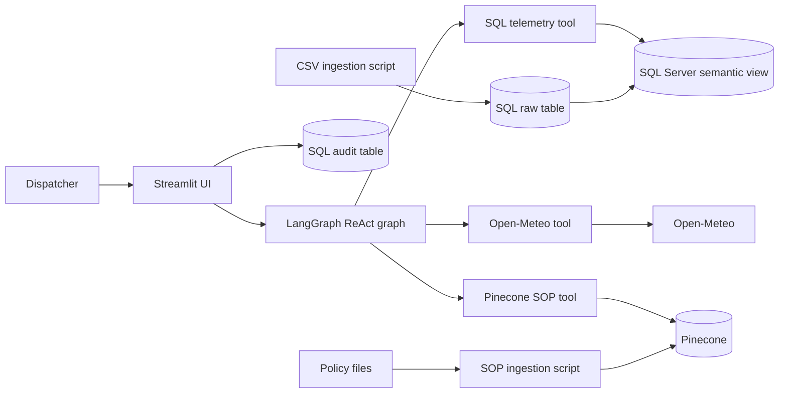
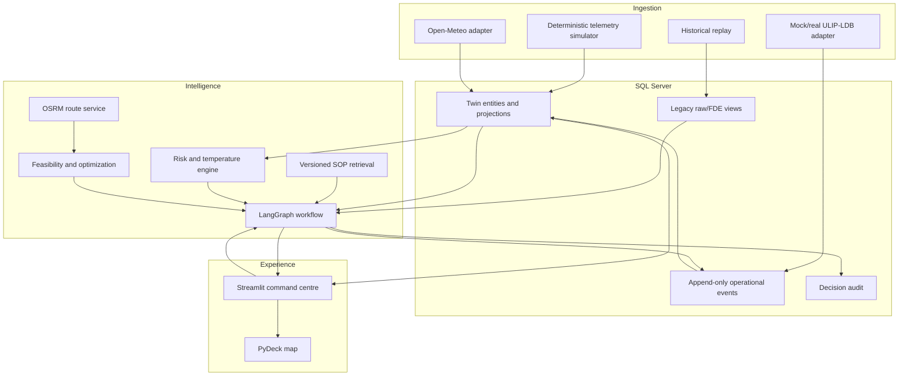
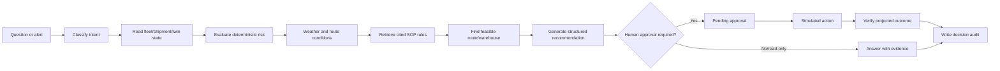
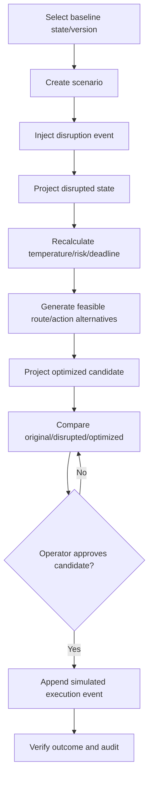
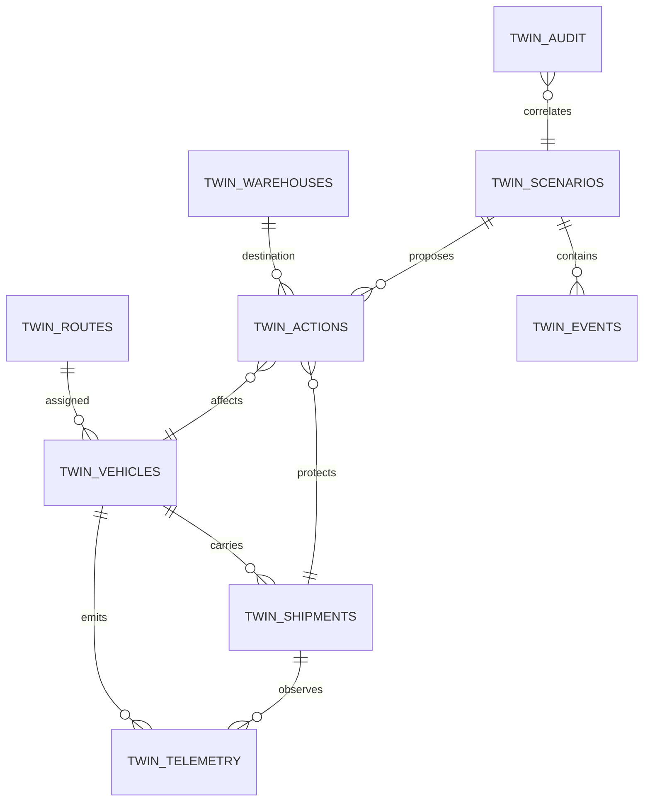

# REEFERTWIN AI: Implementation Plan

**Status:** Updated after local Streamlit and Playwright verification  
**Repository assessed:** `cold-chain-logistics`  
**Assessment basis:** Repository contents, source inspection, dataset profiling, SOP, TDD, business presentation, and deployment workflow  
**Scope:** Current implementation status, verified local behavior, and remaining delivery plan.

## 0. Verification update (2026-11-13)

The repository is beyond the original planning-only assessment. The local
Streamlit command centre now renders the deterministic twin experience and was
tested with Playwright at `http://127.0.0.1:8501`.

### Verified implemented

- Five-vehicle deterministic twin projection and event counter.
- Overview, digital-twin, fleet, simulation, what-if, AI, and audit pages.
- Explicit simulation advancement and deterministic reset.
- Isolated disruption scenarios, warehouse feasibility/ranking, and
  proposed -> approved -> executed action lifecycle.
- Offline health check and 34 passing unit tests.

### Fixed during verification

- Declared and installed the missing `langchain-ollama==1.1.0` dependency.
- Removed corrupted Unicode startup log output that raised a Windows
  `cp1252` encoding error before the UI could render.

### Not yet verified

- SQL Server-backed projections, audit persistence, migrations, and admin log
  retrieval.
- Pinecone SOP retrieval, external weather calls, and an actual Ollama model
  response.
- Docker build/container health, EC2 deployment, GitHub Actions execution, and
  rollback.

The complete browser and test evidence is in
[`PROJECT_REPORT.md`](../PROJECT_REPORT.md). Configuration tests now isolate
`.env` loading, and the full suite returns 34/34.

## 1. Executive summary

The repository is a functional proof of concept for a conversational cold-chain
assistant with a deterministic in-process Digital Twin demo. It has a LangGraph
tool loop, a multi-page Streamlit command centre, deterministic telemetry and
state projection, predictive risk/temperature logic, isolated scenarios,
warehouse ranking, operator approval, a SQL Server ingestion path, a Pinecone
SOP ingestion script, a weather lookup, and a least-privilege intent in the
SQL design. The local twin workflows are browser-verified, but the
SQL-backed operational deployment and external integrations remain
unverified.

The recommended hackathon architecture is to **extend SQL Server as the
single primary operational store**, preserve the original FDE dataset as
immutable historical data, and add a separate `Twin_*` schema for simulated
and derived state. Add a small Python domain layer around the existing
LangGraph graph and Streamlit application. Use OSRM for route geometry and
travel estimates, OR-Tools only for constrained assignment/ranking, Open-Meteo
for external weather, and Pinecone for versioned compliance retrieval.
Avoid a second agent framework, a premature PostgreSQL/PostGIS migration, and
microservices.

The flagship path should be deterministic:

`compressor failure -> telemetry progression -> risk/deadline calculation ->
SOP retrieval -> feasible cold-storage ranking -> human approval -> isolated
simulated route/action -> before/after KPI and audit trail`.

### Priority definitions

* **P0:** Required for a reliable core prototype and the three-minute demo.
* **P1:** Important for a strong competition submission.
* **P2:** Advanced scalability or realism enhancement.

## 2. Repository assessment

### 2.1 Inventory and implementation status

| Area | Evidence | Status | Reuse decision |
|---|---|---|---|
| SQL ingestion | [`scripts/ingest_legacy_data.py`](../scripts/ingest_legacy_data.py) | Partially implemented; mapping and load path exist, runtime credentials/driver are unverified | Reuse after correcting connection handling and adding validation |
| Semantic SQL view and RBAC | [`scripts/setup_security_and_view.sql`](../scripts/setup_security_and_view.sql) | Partially implemented; view and login policy exist, audit table/grant is separate manual documentation | Extend into versioned migrations and test permissions |
| Agent tools | [`src/agent_tools.py`](../src/agent_tools.py) | Partially implemented; telemetry query, weather, and SOP retrieval exist | Preserve contracts but harden validation, errors, and result schemas |
| LangGraph orchestration | [`src/orchestrator.py`](../src/orchestrator.py) | Implemented as a minimal ReAct loop; production persistence and approval workflow absent | Extend, do not replace |
| System prompt | [`src/prompts/system_prompt.txt`](../src/prompts/system_prompt.txt) | Implemented for the three existing tools | Replace with versioned role/routing/output prompts after tool contracts stabilize |
| Streamlit UI | [`src/ui.py`](../src/ui.py), [`src/ui_dashboard.py`](../src/ui_dashboard.py) | Implemented local multi-page twin command centre; SQL-backed audit and live integrations remain unverified | Preserve shell/session model; harden persistence and external-service states |
| SOP/vector ingestion | [`scripts/ingest_sop_pinecone.py`](../scripts/ingest_sop_pinecone.py) | Configured and plausibly functional; Pinecone index, dimensions, and parser are unverified | Reuse with metadata/versioning and safe error policy |
| Policy | [`data/policy/Cold_Chain_Incident_SOP_v2.md`](../data/policy/Cold_Chain_Incident_SOP_v2.md) | Implemented source policy with three explicit rule groups | Preserve as source of truth; do not invent rules |
| Historical data | [`data/raw/dynamic_supply_chain_logistics_dataset.csv`](../data/raw/dynamic_supply_chain_logistics_dataset.csv) | Present, 32,065 x 26, no nulls; synthetic-looking observations without entity IDs | Preserve as baseline/legacy source, not as live twin state |
| Deployment | [` .github/workflows/deploy.yml`](../.github/workflows/deploy.yml) | Configured manual SSH restart; health checks, build/test, secrets bootstrap absent | Extend for reproducible deployment |
| Documentation | [`docs/instrutions.md`](../docs/instrutions.md), PDFs under [`Misc/Materials/`](../Misc/Materials/) | Useful runbook/TDD/business narrative; procedures contain credentials and drift | Correct and consolidate, without copying secrets |
| Tests | [`tests/unit/`](../tests/unit/) | 33 focused unit tests pass; live SQL/integration coverage remains unverified | Add SQL, external-service, restart, and E2E coverage |

### 2.2 Current runtime architecture



The presentation layer currently imports and constructs the graph in-process.
The graph uses `MemorySaver`, so checkpoint state is process memory and is not
durable across restart or multiple app workers. The UI stores displayed
messages in Streamlit session state, while audit writes are attempted through a
separate SQL connection.

### 2.3 Important verified findings

1. The source CSV has 32,065 rows and 26 columns spanning 2021-01-01 through
   2024-08-29. It has no vehicle ID, shipment ID, humidity, compressor state,
   cargo type, warehouse, route geometry, or event identity.
2. The ingestion script maps only nine CSV columns to the legacy table. The
   view exposes timestamp, coordinates, temperature, condition, risk, delay,
   port congestion, and route risk. The source columns for fuel, ETA,
   humidity, compressor health, and cargo value are not represented in the
   view.
3. The dataset contains one unique coordinate per row and random-looking
   point observations. It cannot by itself represent a moving truck track or
   a shipment timeline.
4. The SOP defines fresh perishables as `0.0°C–4.0°C`, a breach above `4.0°C`,
   auxiliary cooling contact, diversion after more than one hour ETA delay,
   port diversion above congestion `7.0`, and Tier 2 escalation for High Risk
   plus delay probability above `0.65`.
5. The current tool code uses a literal redacted password marker in connection
   strings rather than interpolating the loaded password. Runtime connectivity
   is therefore **not verified** and likely fails unless the marker is changed
   outside the repository. This is a P0 stabilization item.
6. `query_telemetry_db` only checks that text begins with `SELECT`; it does not
   constrain the query to the semantic view, selected columns, row count,
   timeout, or result shape. Database RBAC is the primary control, but
   application-level allowlisting is still required.
7. Exceptions in tools are returned as success-shaped strings, and audit
   failures are explicitly silent. The target must use typed results with
   explicit degraded/error states.
8. The SQL setup script does not create `AgentAuditLog`; its creation and grant
   are a separate manual step in [`docs/instrutions.md`](instrutions.md).
9. The TDD describes fields such as shipment ID and cargo type that the actual
   view does not expose. The roadmap must treat the TDD as intended design,
   not as evidence of implementation.
10. The workflow performs `git pull` and restarts Streamlit but does not run
    tests, build an artifact, verify a health endpoint, or roll back.
11. The repository has no visible `.env`, test suite, container definition,
    migration framework, API service, IaC, observability setup, or scheduled
    telemetry worker. Their existence/configuration is **unverified**.

## 3. Gap analysis

| Area | Existing implementation | Limitations and missing capability | Required change / files | Priority |
|---|---|---|---|---|
| A. Data infrastructure | CSV plus SQL Server raw table/view | No canonical entities, ingestion contract, timestamps/quality, or stream lifecycle | Add `src/domain/models.py`, `src/twin/telemetry_simulator.py`, migrations, data-quality checks; preserve raw table | P0 |
| B. SQL architecture | `dbo.TBL_SC_FLEET_HIST_RAW`, `FDE_VIEWS.VW_ACTIVE_FLEET` | Flat view, no IDs/relationships, manual audit DDL, no scenario isolation | Add `Twin` schema and migrations for vehicles, shipments, telemetry, warehouses, routes, events, scenarios, actions, audit; retain legacy schema | P0 |
| C. Geospatial data | Latitude/longitude fields and weather coordinates | No road network, route geometry, distance, geofencing, or spatial indexes | Add route service adapter, normalized geometry representation (GeoJSON/polyline), coordinate validation; SQL spatial types only if supported by deployment | P1 |
| D. IoT ingestion | Historical CSV load only | No generator, idempotency, freshness, quality flags, or real-time loop | Add simulator and ingest service with deterministic seed, event IDs, frequency, batch/stream modes | P0 |
| E. ULIP/LDB | None; only requested conceptually | No real or mock adapter, schema mapping, provenance, or capability boundary | Add `src/integrations/ulip_adapter.py` with explicit mock mode and event envelope; never claim live integration | P1 |
| F. LangGraph | One reasoner node and generic `ToolNode` | No typed state, risk/optimization nodes, approval gate, bounded loops, durable checkpoints, or monitoring trigger | Extend `src/orchestration/graph.py` or orchestrator with deterministic domain nodes; keep existing graph as compatibility entry point | P0 |
| G. Vector RAG | Pinecone ingestion/retrieval, `k=2` | Index/version/authority metadata, citations, retrieval tests, and stale-data behavior absent | Add rule metadata, source/version citation, retrieval evaluation, and explicit unavailable state | P0 |
| H. Weather | Open-Meteo current weather lookup | No caching, provenance/age, forecast horizon, retry/backoff, rate policy, or route sampling | Add weather client/cache and typed weather snapshot; distinguish external from simulated weather | P1 |
| I. Predictive analytics | Source risk/delay columns only | No calibrated model, feature pipeline, monitoring, or explanation | Start with deterministic risk engine; later add offline model behind same interface | P0 |
| J. Temperature forecasting | None | No progression, excursion duration, breach time, or safe intervention deadline | Add transparent compartment/ambient model with bounded assumptions and tests | P0 |
| K. Twin state | None | No current state, version, event ordering, or baseline/derived separation | Add append-only events plus current projections and state versioning | P0 |
| L. Simulation | None | No scenario copy-on-write, disruption injection, comparison, or reproducibility | Add scenario service with baseline/disrupted/optimized projections | P0 |
| M. Route optimization | None | No road route or feasibility constraints | OSRM adapter plus feasibility/ranking; OR-Tools only after single-vehicle flow works | P0/P1 |
| N. Warehouse allocation | None | No facilities, capacity, temperature capability, availability, or destination policy | Add seed warehouses and constraint filter/ranker | P0 |
| O. Streamlit frontend | Chat and audit screens | No pages, map, timeseries, controls, approval, or live refresh | Extend `src/ui.py` or split into `src/ui/` pages after domain APIs exist | P0 |
| P. Geospatial visualization | None | No map layer or route comparison | Use PyDeck/Deck.gl via Streamlit; render baseline/disrupted/optimized separately | P1 |
| Q. Audit/events | Manual SQL table and UI viewer | Schema absent from setup, incomplete fields, silent errors, no correlation/idempotency | Add append-only typed audit/event records and mandatory decision correlation | P0 |
| R. Financial/carbon | Source shipping cost only | No cargo value, avoided loss, diversion cost, fuel/emission factors | Add transparent parameterized calculators and label estimates | P1 |
| S. Deployment/scalability | EC2 systemd and manual SSH workflow | Secrets in runbook, no container/health/test/rollback, in-process state | Containerize, externalize secrets, add health check and deployment gate; single-node is sufficient for demo | P0 |
| T. Testing/reliability | No test files or CI test job | No deterministic scenario or failure tests | Add unit, integration, simulation, E2E smoke, startup and recovery tests | P0 |

## 4. Target architecture

### 4.1 Recommended layers

1. **Ingestion:** deterministic simulator, CSV replay, external weather
   adapter, and clearly separated mock ULIP/LDB adapter.
2. **Operational storage:** SQL Server `Twin` schema, original legacy schema
   read-only, append-only events, current-state projections, and audit.
3. **Intelligence:** typed domain services, Pinecone compliance retrieval,
   Open-Meteo client, and existing LangGraph orchestration.
4. **Prediction:** deterministic risk, temperature progression, threshold
   breach/deadline, and compressor-health evaluation.
5. **Simulation:** immutable baseline plus scenario event stream and derived
   disrupted/optimized states.
6. **Optimization:** OSRM route candidates and geometry; constrained
   warehouse/route feasibility and ranking; OR-Tools for multi-vehicle
   assignment when justified.
7. **Interface:** Streamlit command centre with map, KPIs, telemetry,
   simulation lab, approval flow, AI report, analytics, and audit.
8. **Action/verification:** approval token, simulated action event, state
   projection update, outcome verification, and financial/carbon estimate.



### 4.2 Data flow and state rules

* Raw FDE records are never overwritten.
* External weather snapshots carry `source`, `observed_at`, `retrieved_at`,
  and freshness status. Simulated weather is a different source.
* Every simulator or approved action emits an idempotent event with
  `event_id`, `aggregate_type`, `aggregate_id`, `occurred_at`, `scenario_id`,
  `source`, and payload.
* A projection worker or transaction updates current twin state from ordered
  events. The projection includes a monotonically increasing `state_version`.
* A scenario references a baseline snapshot/version and appends hypothetical
  events only within that scenario. It does not update production/baseline
  projections.
* The UI reads projections and scenario comparisons; it does not calculate
  authoritative risk or mutate tables directly.

### 4.3 Agent execution workflow



Continuous monitoring invokes the same domain workflow from an alert
dispatcher, not from an LLM. The alert dispatcher runs risk evaluation on new
telemetry, debounces repeated alerts, and submits a structured incident to
LangGraph. Chat can query or request a scenario using the same typed services.
No hidden chain-of-thought is persisted; store inputs, tool calls, rule
citations, outputs, approvals, and outcome metrics.

### 4.4 Simulation workflow



### 4.5 Database relationship model



## 5. Technology decisions

### 5.1 Primary database: extend SQL Server

**Recommendation:** Keep SQL Server for the prototype. Add a `Twin` schema
and migrations; retain `dbo` legacy data and `FDE_VIEWS` compatibility views.

**Why:** SQL Server already exists in the project, supports relational
constraints, transactions, temporal/event tables, spatial types if needed,
and is sufficient for 5–10 simulated trucks. A migration to PostgreSQL/PostGIS
would add operational risk without being required for the demo.

**Alternatives:** PostgreSQL/PostGIS is attractive for production-grade
geospatial indexing and richer spatial functions; a hybrid SQL Server +
PostGIS design is unjustified for the prototype. Reconsider only when route
search or spatial scale is demonstrated as a bottleneck.

**Impact:** Add migrations, connection pooling, separate read/write service
credentials, indexes, and integration tests. Do not let the LLM receive raw
table access. Use application query functions with parameterized SQL.

### 5.2 LangGraph

Preserve the current `StateGraph` and `ToolNode` approach. Add typed state,
bounded transitions, deterministic domain nodes, approval interrupts, durable
checkpoint storage, and structured tool outputs. Do not create a second
agent framework. The LLM should select and explain actions; deterministic
services calculate risk, feasibility, cost, and carbon.

### 5.3 Pinecone

Keep Pinecone for compliance retrieval because ingestion and retrieval are
already present. Add `policy_version`, `effective_date`, `authority`,
`section`, `content_hash`, and `source_file` metadata. Retrieval must return
citations and an explicit `knowledge_unavailable` status. Never allow a
missing vector result to become an invented rule.

### 5.4 Routing and optimization

* **OSRM:** road distance, duration, route geometry, and candidate route
  calculations. Mark responses as live or simulated and retain the request
  parameters.
* **OR-Tools:** constrained assignment across multiple vehicles, warehouses,
  capacity, deadlines, and objective weights. Do not use it for the first
  single-vehicle route call if deterministic ranking is sufficient.
* **Fallback:** if OSRM is unavailable, show straight-line estimate only as a
  clearly labelled fallback and never present it as a road route.

### 5.5 Frontend and visualization

Streamlit remains appropriate for the hackathon because it is already wired,
fast to iterate, and adequate for 5–10 vehicles. Use PyDeck/Deck.gl for
vehicles, route layers, warehouses, alerts, and baseline/disrupted/optimized
overlays. Use Plotly or native Streamlit charts for telemetry histories.
A separate React frontend is not justified until interaction latency,
multi-user concurrency, or map requirements exceed Streamlit.

Use polling (for example 2–5 seconds in demo mode) against projections rather
than WebSockets. A background simulator can persist events; the UI refreshes
read-only state. WebSockets are P2.

### 5.6 Weather

Retain Open-Meteo, but wrap it in a client with timeout, retry/backoff,
cache key, response timestamp, forecast horizon, rate limiting, and source
status. Weather API failure must produce stale/missing status, not a normal
weather value.

### 5.7 Deployment

Reuse EC2, systemd, and GitHub Actions for the submission. Prefer a
single Docker image plus SQL Server as the existing managed/container
dependency; if Docker is not available on the target host, keep the venv
fallback. Add GitHub Actions test gates, secret injection, health checks,
structured logs, and rollback to the last known-good image/commit. Never put
credentials in documentation or shell history.

## 6. Proposed data model

The following is a logical design. Types should be adapted to the deployed
SQL Server version and migration tool.

| Table | Purpose and key columns | Retention/indexing |
|---|---|---|
| `Twin.Vehicles` | `vehicle_id` PK, registration, status, current lat/lon, speed, route ID, compressor state/health, fuel, `state_version` | Current projection; index status and location; history via events |
| `Twin.Shipments` | `shipment_id` PK, vehicle ID, cargo category, value, quantity, origin/destination, min/max temperature, ETA | Current shipment; index vehicle, risk, destination |
| `Twin.Telemetry` | `telemetry_id` PK, event ID unique, vehicle/shipment IDs, event time, GPS, internal/external temperature, humidity, compressor, fuel, quality/source/scenario | Append-only; indexes `(vehicle_id, observed_at DESC)` and scenario |
| `Twin.Warehouses` | warehouse ID PK, coordinates, capacity, available capacity, supported temperature range, availability | Current capacity; index availability and geography |
| `Twin.Routes` | route ID PK, origin/destination, geometry, distance, duration, source, calculated time | Version route candidates; index vehicle/scenario |
| `Twin.Events` | event ID PK, aggregate, event type, payload JSON, occurred time, source, scenario, correlation ID | Append-only; unique event ID and aggregate/time |
| `Twin.Scenarios` | scenario ID PK, baseline version, type, parameters JSON, status, seed, created/approved times | Keep all demo scenarios |
| `Twin.Actions` | action ID PK, scenario/vehicle/shipment/warehouse, recommendation, route, ETA, cost, carbon, approval/execution statuses | Append-only lifecycle; index scenario/status |
| `Twin.Weather` | snapshot ID PK, location, observed/retrieved time, values, source, freshness/status, scenario | Append-only/cache; index location/time |
| `Twin.Audit` | audit ID PK, correlation/session/user, node/tool, input/output summaries, citations, approval, status/error | Append-only; index correlation/time |

Separate production/baseline records from scenario records using `scenario_id`
NULL for baseline and a non-NULL scenario ID for hypothetical state. A
scenario can also use a separate projection table if query isolation is
preferable. Never update historical telemetry to represent a disruption.

### 6.1 DDL example

```sql
CREATE SCHEMA Twin;
GO

CREATE TABLE Twin.Vehicles (
    vehicle_id VARCHAR(40) NOT NULL PRIMARY KEY,
    registration VARCHAR(40) NOT NULL UNIQUE,
    status VARCHAR(30) NOT NULL,
    latitude DECIMAL(9,6) NOT NULL,
    longitude DECIMAL(9,6) NOT NULL,
    speed_kph DECIMAL(8,2) NULL,
    route_id VARCHAR(40) NULL,
    compressor_state VARCHAR(30) NOT NULL,
    compressor_health DECIMAL(5,4) NOT NULL,
    fuel_level_percent DECIMAL(5,2) NULL,
    state_version BIGINT NOT NULL DEFAULT 0,
    updated_at DATETIME2(3) NOT NULL
);

CREATE TABLE Twin.Shipments (
    shipment_id VARCHAR(40) NOT NULL PRIMARY KEY,
    vehicle_id VARCHAR(40) NOT NULL,
    cargo_category VARCHAR(60) NOT NULL,
    cargo_value DECIMAL(18,2) NULL,
    quantity DECIMAL(18,3) NULL,
    min_temp_c DECIMAL(6,2) NOT NULL,
    max_temp_c DECIMAL(6,2) NOT NULL,
    origin_name VARCHAR(160) NOT NULL,
    destination_name VARCHAR(160) NOT NULL,
    status VARCHAR(30) NOT NULL,
    CONSTRAINT FK_Shipment_Vehicle FOREIGN KEY (vehicle_id)
        REFERENCES Twin.Vehicles(vehicle_id)
);

CREATE TABLE Twin.Events (
    event_id UNIQUEIDENTIFIER NOT NULL PRIMARY KEY,
    aggregate_type VARCHAR(40) NOT NULL,
    aggregate_id VARCHAR(80) NOT NULL,
    event_type VARCHAR(80) NOT NULL,
    occurred_at DATETIME2(3) NOT NULL,
    source VARCHAR(40) NOT NULL,
    scenario_id UNIQUEIDENTIFIER NULL,
    correlation_id UNIQUEIDENTIFIER NOT NULL,
    payload NVARCHAR(MAX) NOT NULL,
    CONSTRAINT CK_Event_Payload CHECK (ISJSON(payload) = 1)
);

CREATE UNIQUE INDEX UX_Telemetry_Event ON Twin.Telemetry(event_id);
CREATE INDEX IX_Telemetry_Vehicle_Time
    ON Twin.Telemetry(vehicle_id, observed_at DESC);
CREATE INDEX IX_Event_Aggregate_Time
    ON Twin.Events(aggregate_type, aggregate_id, occurred_at);
```

The remaining tables should be added in migrations, not as ad hoc manual
production commands. Use parameterized inserts and a separate write service
account. The LLM-facing read account should receive curated views such as
`FDE_VIEWS.VW_TWIN_ACTIVE_FLEET`, not unrestricted `Twin` tables.

### 6.2 Event envelope

```json
{
  "event_id": "uuid",
  "event_type": "telemetry.observed",
  "aggregate_type": "vehicle",
  "aggregate_id": "REEFER-003",
  "occurred_at": "2026-11-10T08:40:00Z",
  "source": "simulator",
  "scenario_id": null,
  "correlation_id": "uuid",
  "schema_version": 1,
  "payload": {
    "latitude": 19.076,
    "longitude": 72.877,
    "internal_temperature_c": 3.2,
    "ambient_temperature_c": 30.0,
    "humidity_percent": 67.0,
    "compressor_state": "healthy",
    "fuel_level_percent": 72.0
  }
}
```

## 7. Telemetry simulation

### 7.1 Module structure

```text
src/
  domain/
    models.py                 # Pydantic/domain contracts
    enums.py
  twin/
    telemetry_simulator.py    # deterministic vehicle ticks
    state_manager.py          # event append and projections
    scenarios.py              # isolated scenario lifecycle
  predictive/
    temperature.py
    risk.py
  optimization/
    osrm_client.py
    warehouse_ranker.py
    assignment.py
  integrations/
    weather.py
    ulip_adapter.py
  orchestration/
    graph.py
    tools.py
  ui/
    pages/
    components/
tests/
  unit/
  integration/
  simulation/
```

### 7.2 Simulator rules

* Seed 5–10 vehicles, including `REEFER-003`, each with a shipment,
  predefined route waypoints, cargo limits, and starting state.
* Default tick: one simulated minute; demo control can advance 1, 5, or
  15 minutes per tick. Persist ticks in batches while retaining event time.
* Movement follows interpolated route waypoints, bounded by speed and a
  deterministic seed. Do not imply GPS precision beyond the simulation.
* Healthy temperature approaches a cargo setpoint with small seeded noise.
  Ambient heat increases the equilibrium temperature. Compressor failure
  changes the model parameters and emits one disruption event.
* Sensor values include quality flags and bounded fluctuation. Invalid
  coordinates, impossible humidity, and missing timestamps are rejected or
  marked degraded.
* The simulator writes events through `state_manager`, never directly
  overwriting a baseline telemetry row.
* A `DemoScenarioConfig` stores seed, start time, tick size, routes,
  warehouse inventory, and disruption schedule. Resetting the scenario with
  the same config reproduces the same observations.

### 7.3 Simulator-to-twin communication

`TelemetrySimulator.tick()` returns typed `TelemetryEvent` objects. The state
manager validates and appends them in one transaction, then updates the
current projection. The UI observes the projection. A scenario manager wraps
the same interface with a scenario ID and a baseline version. This keeps the
simulator independent from Streamlit and makes tests deterministic.

## 8. Predictive risk engine

### 8.1 Initial deterministic model

Inputs:

* current internal temperature and permitted min/max;
* deviation and rolling rate of change;
* compressor state/health;
* ambient temperature;
* estimated time to destination/intervention;
* cargo-specific rule metadata;
* telemetry quality and freshness.

Outputs:

```json
{
  "status": "normal|warning|critical|unknown",
  "temperature_deviation_c": 0.4,
  "rate_c_per_hour": 0.8,
  "estimated_breach_minutes": 48,
  "safe_intervention_deadline": "timestamp",
  "evidence": ["telemetry ids", "rule citation"],
  "limitations": ["deterministic estimate; not spoilage validation"]
}
```

Suggested states:

* **Normal:** fresh data, inside limits, stable trend, and no active critical
  equipment condition.
* **Warning:** approaching a threshold, adverse trend, stale telemetry, or
  degraded compressor with remaining intervention margin.
* **Critical:** current breach, projected breach before the next feasible safe
  intervention, or an explicit compressor failure with no safe margin.
* **Unknown:** insufficient or stale data; do not silently downgrade to
  normal.

Estimate threshold time by fitting a bounded slope to recent temperature
observations and projecting to the permitted boundary. If the slope is
non-positive toward the boundary, return `null` rather than infinity. Apply
configured confidence/quality guards. This estimates a threshold crossing,
not spoilage, shelf life, or product stability. Do not claim a scientifically
validated spoilage rate. Later ML can implement the same interface, trained
offline and evaluated for calibration, but should not replace the transparent
baseline during the demo.

## 9. LangGraph workflow and tool contracts

All tools should return typed, JSON-serializable envelopes:

```json
{"status":"ok|degraded|error","data":{},"evidence":[],"warnings":[],"correlation_id":"uuid"}
```

| Tool | Input | Responsibility | Status |
|---|---|---|---|
| `get_live_fleet_state` | filters, scenario ID | Read current projected vehicles and alerts | New |
| `get_truck_telemetry` | vehicle ID, time range, scenario ID | Read bounded telemetry history | New |
| `get_shipment_details` | shipment ID/vehicle ID | Read cargo limits/value/destination | New |
| `get_route_weather` | coordinate/route, time horizon, scenario ID | Retrieve cached external or simulated snapshots | Extend weather tool |
| `retrieve_compliance_rules` | cargo category, incident type | Pinecone retrieval with source/version citation | Extend SOP tool |
| `evaluate_cargo_risk` | typed telemetry/shipment snapshot | Deterministic risk/deadline calculation | New |
| `find_nearest_cold_storage` | location, cargo limits, time limit | Filter facilities by capability/availability | New |
| `get_warehouse_availability` | facility IDs/time | Capacity and availability snapshot | New |
| `calculate_alternative_route` | origin, destination, constraints | OSRM route and travel estimate | New |
| `optimize_warehouse_assignment` | vehicle, candidates, constraints | Feasibility and ranking; later OR-Tools | New |
| `simulate_disruption` | scenario ID/type/parameters | Append hypothetical event and project state | New |
| `recommend_dispatch_action` | risk, SOP, alternatives | Structured action with rationale/citations | New |
| `record_decision_audit` | correlation, inputs, outputs, approval | Append audit record | New |

Existing tools should be adapted rather than duplicated. `query_telemetry_db`
must become a bounded, parameterized read service; arbitrary SQL text should
not be an LLM-facing interface. `fetch_corridor_conditions` becomes the
weather adapter. `search_compliance_sop` becomes the cited rule retriever.

Recommended nodes:

1. `load_context`
2. `evaluate_risk`
3. `get_conditions`
4. `retrieve_rules`
5. `find_options`
6. `compose_recommendation`
7. `approval_interrupt`
8. `execute_simulated_action`
9. `verify_outcome`
10. `record_audit`

Use bounded retries for transient integrations, explicit error branches, and
an approval interrupt for actions. Use durable checkpointer storage for
multi-user deployment; `MemorySaver` is acceptable only for local smoke tests.

## 10. What-if scenarios

| Scenario | Parameters | State changes and expected response |
|---|---|---|
| Heatwave | ambient delta, duration, corridor | Weather/temperature projection changes; recompute deadline and route |
| Compressor failure | vehicle, failure time, severity | Compressor state fails; temperature slope increases; urgent intervention |
| Temperature spike | vehicle, delta, duration | Telemetry anomaly; evaluate current breach and recovery |
| Traffic congestion | segment, delay, duration | Route ETA changes; test SOP diversion threshold |
| Highway closure | segment, closure interval | Remove route candidate/penalize it; reroute |
| Capacity reduction | warehouse, remaining capacity | Recompute facility feasibility |
| Warehouse unavailable | warehouse, interval | Exclude facility; report no feasible destination if applicable |

Scenario state consists of:

`baseline_version -> disruption_events -> disrupted_projection ->
candidate_actions -> optimized_projection -> outcome`.

The comparison UI must show original, disrupted, and optimized values for
temperature, breach time, ETA, route distance, destination, cost, carbon, and
risk. `scenario_id` is mandatory on every hypothetical event and query.

## 11. Route and warehouse optimization

1. Validate coordinates and cargo constraints.
2. Obtain candidate cold-storage facilities that support the cargo temperature
   range and have available capacity at the estimated arrival time.
3. Ask OSRM for road distance, duration, and geometry for each candidate.
4. Reject candidates whose ETA exceeds the safe intervention deadline, whose
   capacity is insufficient, or whose route is disrupted/unavailable.
5. Rank feasible candidates by a documented weighted objective:
   safety margin first, then arrival time, cargo value protected, added cost,
   carbon, and distance. Weights belong in scenario configuration.
6. Return all candidates with rejection reasons, not merely the winner.
7. If no candidate is feasible, return a critical escalation requiring human
   logistics intervention; do not fabricate a destination.

OSRM route geometry is actual routing output at calculation time. Traffic,
closure, and weather penalties injected by the simulator must be marked
`simulated_assumption`. The route returned to the twin is an action candidate
until approved.

## 12. Streamlit command centre

Keep the current session/thread model and chat experience, but make domain
services callable without importing UI code. The proposed pages are:

| Page | Components and data | Refresh / priority |
|---|---|---|
| Overview | KPI cards, active alerts, risk distribution, fleet status, stale-data banner | 5s polling; P0 |
| Digital Twin | PyDeck vehicles, routes, warehouses, weather/risk layers; baseline/disrupted/optimized toggles | 2–5s demo polling; P0 |
| Fleet management | Vehicle table, compressor state, telemetry chart, ETA, risk/deadline | On selection + polling; P0 |
| Shipment intelligence | Cargo limits, temperature history, SOP citations, handling events | On selection; P1 |
| Simulation lab | Scenario type, vehicle, parameters, create/reset/run, comparison charts | User-triggered; P0 |
| AI command centre | Structured recommendation, evidence, tool trace summaries, approval/reject | User-triggered; P0 |
| Analytics | Value protected, avoided loss estimate, diversion cost, carbon delta, assumptions | After scenario/action; P1 |
| Audit trail | Correlation, event, tool, approval, outcome, error and source filters | On demand; P0 |

The chat remains a natural-language entry point to read state, request a
scenario, or ask why a recommendation was made. It must not bypass approval
or directly mutate state. Do not display raw hidden reasoning; show concise
decision evidence and tool outcomes.

## 13. Financial and carbon analytics

Use explicit configuration, not invented claims:

* `estimated_loss_avoided = cargo_value * configured_loss_fraction`, only when
  the scenario outcome protects the shipment; label as estimate.
* `incremental_transport_cost = diverted_distance * configured_cost_per_km +
  fixed_handling_cost`.
* `carbon_delta = distance_delta * vehicle_emission_factor`, with factor
  source/version shown.

If cargo value or emission factors are absent, return `not_available` with the
missing inputs. Do not present synthetic estimates as measured business
outcomes.

## 14. Phased roadmap

### Phase 0 — Stabilize the existing project (P0, 2–3 days) — PARTIAL

**Objective:** Make the current assistant reproducibly start, connect, and
fail explicitly before adding twin features.

* Reuse the current graph, tools, SOP, SQL view, and Streamlit shell.
* Modify [`src/agent_tools.py`](../src/agent_tools.py),
  [`src/orchestrator.py`](../src/orchestrator.py), [`src/ui.py`](../src/ui.py),
  [`scripts/ingest_legacy_data.py`](../scripts/ingest_legacy_data.py), and
  [`scripts/setup_security_and_view.sql`](../scripts/setup_security_and_view.sql).
* Create `tests/unit/`, `tests/integration/`, `scripts/migrations/`, and
  `src/config.py`.
* Replace literal password markers with secret-derived values, validate
  required configuration, use bounded parameterized queries, and add
  connection timeouts.
* Create the audit table in the migration path; make audit failures explicit
  and observable.
* Add structured result envelopes and a health/startup check.
* Correct runbook drift and remove credential values from documentation.

**Dependencies:** existing Python environment, SQL Server, ODBC driver,
Pinecone/Open-Meteo credentials where enabled.

**Acceptance:** a clean environment can run the startup check; the agent
answers the existing telemetry/weather/SOP question, the no-tool explanation
uses no tool, unauthorized SQL is rejected, and an external/API failure is
shown as degraded. Tests cover connection configuration and tool validation.

**Risks:** unavailable SQL/Pinecone credentials. Mitigate with explicit
offline fixture mode, never a success-shaped fake production result.

**Verification update:** offline health, source compilation, and the full
30-test suite pass. The Streamlit startup blockers found during Playwright
testing were fixed.

### Phase 1 — Data infrastructure and telemetry (P0, 4–6 days) — LOCAL DEMO COMPLETE

**Objective:** Establish persistent twin entities and deterministic 5–10
vehicle simulation.

* Create `src/domain/`, `src/twin/`, migrations, seed data, and telemetry
  tests.
* Add `Twin` schema, append-only events, current projections, indexes, and
  curated read views.
* Add `telemetry_simulator.py`, `state_manager.py`, and event schemas.
* Seed `REEFER-001` through `REEFER-005`, shipments, routes, and warehouses,
  with `REEFER-003` reserved for the demo.
* Add baseline/replay mode and reproducible seed/reset controls.
* Keep original FDE tables untouched and label external versus simulated
  telemetry.

**Acceptance:** five vehicles move on valid routes; a tick creates idempotent
  events and projection updates; reset with the same seed reproduces output;
  baseline historical rows remain unchanged; stale/invalid telemetry is
  visible as degraded.

**Dependencies:** Phase 0 database connectivity and migrations.

**Risks:** synthetic data not behaving like a track. Mitigate with fixed
  route waypoints and validation plots/queries.

  **Verification update:** the deterministic five-vehicle store, event
  projection, telemetry history, explicit tick controls, and reset behavior are
  implemented and covered by unit tests. Persistence in SQL Server is still
  unverified.

### Phase 2 — Predictive intelligence and agent upgrade (P0, 5–7 days) — LOCAL DEMO PARTIAL

**Objective:** Make risk/deadline decisions deterministic and expose them
through an auditable LangGraph workflow.

* Create `src/predictive/temperature.py` and `risk.py`.
* Create typed integration clients for weather, Pinecone, and optional
  ULIP/LDB mock envelope.
* Extend tools and graph nodes per Sections 8–9.
* Add citations, bounded retries, error branches, approval interrupt, and
  durable checkpoint configuration.
* Add alert debounce/continuous-monitoring trigger.

**Acceptance:** compressor failure produces a projected threshold crossing
  time; risk state is normal/warning/critical/unknown with evidence; SOP
  citation matches the source policy; no action executes without approval;
  every cycle has a correlation ID and audit record.

**Dependencies:** Phase 1 entities/projections.

**Risks:** model overclaiming spoilage. Mitigate by enforcing language and
  output schemas that distinguish breach, risk, safe intervention time, and
  unknown.

  **Verification update:** deterministic risk/temperature evidence is visible in
  the Digital Twin page and the AI page renders. A live model call, external
  retrieval, and durable audit cycle remain unverified.

### Phase 3 — Interactive Digital Twin frontend (P0/P1, 4–6 days) — COMPLETE LOCALLY

**Objective:** Turn the existing chat UI into a demonstrable command centre.

* Split UI components/pages from the current monolith only after service
  contracts exist.
* Add Overview, Digital Twin, Fleet, Simulation Lab, AI, and Audit pages.
* Add PyDeck map, route/status layers, telemetry charts, alert banners,
  refresh/pause controls, and scenario selector.
* Keep current chat as an AI Command Centre input/output.

**Acceptance:** operator can select a vehicle on a map, see current telemetry,
  risk evidence, route, shipment, and audit correlation; UI refresh does not
  mutate state and remains usable when weather is stale.

**Dependencies:** Phases 1–2 and map visualization dependency.

**Risks:** Streamlit reruns causing duplicate actions. Mitigate with
  idempotency keys, explicit button confirmation, and server-side action state.

  **Verification update:** Playwright verified Overview, Digital Twin, Fleet,
  Simulation Lab, AI Command Centre, and Audit pages. It also verified the map,
  telemetry chart, risk filters, and explicit simulation controls.

### Phase 4 — What-if simulation and optimization (P0/P1, 5–8 days) — COMPLETE LOCALLY

**Objective:** Deliver isolated disruption scenarios and feasible action
recommendations.

* Create scenario manager and comparison projections.
* Add compressor failure, heatwave, temperature spike, closure, traffic,
  capacity reduction, and warehouse unavailability.
* Add OSRM client, candidate route service, warehouse feasibility/ranker, and
  action lifecycle.
* Add OR-Tools only if multi-vehicle assignment is required after single
  vehicle flow passes.
* Add approval, simulated execution, verification, cost/carbon analytics.

**Acceptance:** `REEFER-003` compressor failure shows original/disrupted/
  optimized states; original telemetry is unchanged; only feasible facilities
  are offered; no-feasible-destination is explicit; approved action changes
  only the scenario projection; metrics are calculated from inputs.

**Dependencies:** Phase 3 UI controls, Phase 2 risk service, seeded facilities.

**Risks:** external routing outage. Mitigate with cached route fixtures for the
  deterministic demo, clearly labelled as fixtures.

  **Verification update:** Playwright verified isolated compressor-failure
  scenario creation, warehouse recommendation, and proposed -> approved ->
  executed action lifecycle. SQL persistence and live routing remain
  unverified.

### Phase 5 — Deployment, testing, and competition demo (P0, 3–5 days) — NOT COMPLETE

**Objective:** Make the complete flow repeatable on the target EC2 host.

* Add Dockerfile/compose or a documented single-host equivalent, health check,
  startup validation, structured logging, and resource limits.
* Extend GitHub Actions to install, lint/type-check if configured, run tests,
  build artifact, deploy, smoke test, and report rollback conditions.
* Move all secrets to deployment secret storage; rotate any credentials that
  appeared in historical documentation.
* Add unit, integration, simulation, E2E, recovery, and demo reset tests.
* Run a timed rehearsal and pre-load route/weather/policy fixtures.

**Acceptance:** clean deployment starts within the agreed demo budget, health
check is green, all P0 tests pass, restart preserves baseline and audit data,
scenario reset is deterministic, and the complete demo fits three minutes.

**Verification update:** local Streamlit health, compileall, and Playwright
smoke coverage pass. The suite is 34/34, Docker/EC2/GitHub execution was not
performed, and the Phase 5 report records the missing ODBC runtime and
rollback gaps.

## 15. File-by-file implementation matrix

| File path | Current status / purpose | Action | New responsibility | Dependencies | Priority / phase |
|---|---|---|---|---|---|
| `requirements.txt` | Existing pinned runtime packages | MODIFY | Add only approved map/validation/test packages as needed | Phase design | P0/P1 |
| `src/agent_tools.py` | Three external/data tools | EXTEND | Typed bounded domain tools and explicit errors | SQL, weather, Pinecone | P0 / 0–2 |
| `src/orchestrator.py` | Minimal LangGraph ReAct graph | EXTEND | Import-compatible graph entry point and workflow routing | Domain services, checkpointer | P0 / 0–2 |
| `src/prompts/system_prompt.txt` | Three-tool business prompt | MODIFY | Scope, evidence, approval, and no-overclaim policy | Tool schemas | P0 / 2 |
| `src/ui.py` | Monolithic chat/audit Streamlit app | EXTEND then SPLIT | Command centre shell and page routing | Twin APIs, PyDeck | P0 / 0, 3 |
| `src/config.py` | Not present | CREATE | Typed environment/config validation | Pydantic settings | P0 / 0 |
| `src/domain/models.py` | Not present | CREATE | Shared typed entities/events/results | Pydantic | P0 / 1 |
| `src/domain/enums.py` | Not present | CREATE | Status/source/scenario enums | Domain models | P0 / 1 |
| `src/twin/telemetry_simulator.py` | Not present | CREATE | Deterministic fleet ticks and anomalies | Domain models | P0 / 1 |
| `src/twin/state_manager.py` | Not present | CREATE | Event append and projections | SQL Server | P0 / 1 |
| `src/twin/scenarios.py` | Not present | CREATE | Isolated scenario lifecycle/comparison | State manager, risk | P0 / 4 |
| `src/predictive/temperature.py` | Not present | CREATE | Transparent temperature progression | Domain models | P0 / 2 |
| `src/predictive/risk.py` | Not present | CREATE | Risk/deadline evaluation | Temperature, SOP metadata | P0 / 2 |
| `src/optimization/osrm_client.py` | Not present | CREATE | Route geometry/duration adapter | OSRM | P0 / 4 |
| `src/optimization/warehouse_ranker.py` | Not present | CREATE | Capacity/safety feasibility and ranking | SQL, OSRM, risk | P0 / 4 |
| `src/optimization/assignment.py` | Not present | CREATE | Optional OR-Tools multi-vehicle assignment | OR-Tools | P1 / 4 |
| `src/integrations/weather.py` | Weather logic embedded in tool | CREATE/EXTEND | Cached, typed, sourced weather | Open-Meteo | P1 / 2 |
| `src/integrations/ulip_adapter.py` | Not present | CREATE | Explicit mock/live event boundary | External contract | P1 / 1 |
| `src/orchestration/graph.py` | Not present | CREATE/EXTEND | Testable graph construction separate from UI | LangGraph | P0 / 2 |
| `src/ui/pages/` | Not present | CREATE | Page-level command-centre views | Streamlit | P0/P1 / 3 |
| `src/ui/components/` | Not present | CREATE | Map/cards/charts/approval widgets | PyDeck/Streamlit | P0/P1 / 3 |
| `scripts/ingest_legacy_data.py` | CSV-to-legacy loader | MODIFY | Validated, parameterized, repeatable legacy load | SQL Server | P0 / 0 |
| `scripts/ingest_sop_pinecone.py` | Pinecone parser/upserter | EXTEND | Versioned metadata and ingestion report | Pinecone | P0 / 0–2 |
| `scripts/setup_security_and_view.sql` | View and role setup | MODIFY | Twin views, audit DDL/grants, migration-safe setup | SQL Server | P0 / 0–1 |
| `scripts/migrations/` | Not present | CREATE | Ordered schema changes and rollback notes | SQL Server | P0 / 0–1 |
| `data/raw/` | Historical synthetic CSV | REUSE | Immutable legacy baseline | None | P0 |
| `data/policy/` | SOP source | REUSE | Compliance source of truth | Pinecone | P0 |
| `data/twin/seed/` | Not present | CREATE | Vehicles, shipments, warehouses, waypoints | Simulator | P0 / 1 |
| `tests/unit/` | Not present | CREATE | Risk, temperature, ranking, schemas | Pytest | P0 / 0–5 |
| `tests/integration/` | Not present | CREATE | SQL, weather, Pinecone, graph tools | Services/fixtures | P0 / 0–5 |
| `tests/simulation/` | Not present | CREATE | Scenario and event isolation tests | Twin services | P0 / 4–5 |
| `Dockerfile` / compose | Not present | CREATE | Reproducible app runtime | Existing packages | P0 / 5 |
| `.github/workflows/deploy.yml` | Manual SSH restart | MODIFY | Test/build/deploy/health/rollback gates | GitHub secrets | P0 / 5 |
| `.streamlit/config.toml` | File watcher disabled | MODIFY | Safe server config and refresh limits | Streamlit | P1 / 3–5 |
| `docs/instrutions.md` | Setup runbook | MODIFY | Secret-free, current setup and troubleshooting | Deployment | P0 / 0, 5 |
| `docs/REEFERTWIN_IMPLEMENTATION_PLAN.md` | This blueprint | CREATE | Implementation contract | None | Complete |
| `notes.pdf` | No extractable text | REUSE/ARCHIVE | Reference only until provenance confirmed | None | P2 |
| `Misc/Materials/*.pdf` | TDD/business references | REUSE | Architecture/business constraints | None | P0 |

No existing application file should be deleted in the prototype. The current
three tools remain compatibility tools while the typed domain services are
introduced. Deprecate arbitrary SQL text and direct UI-to-database mutation
after callers migrate.

## 16. Testing strategy

### Unit tests

* Temperature progression under healthy compressor, failure, recovery, heat,
  and no-data conditions.
* Risk boundaries: exactly `4.0°C`, above `4.0°C`, rate direction, stale
  telemetry, Tier 2 condition, and no-feasible deadline.
* Warehouse filter/ranking and tie-breakers.
* Cost/carbon formulas and missing-input behavior.
* Event idempotency, scenario IDs, state-version conflicts, and schema
  validation.

### Integration tests

* SQL migrations, curated views, least-privilege read/write permissions,
  parameterized reads, and audit insert.
* Open-Meteo success, timeout, malformed response, cache, and stale status.
* Pinecone retrieval with source/version citation and unavailable index.
* LangGraph tool routing, bounded retry, approval interrupt, and audit.

### Simulation tests

* Heatwave raises projected temperature without modifying baseline.
* Compressor failure for `REEFER-003` crosses the configured threshold.
* Road closure excludes the affected route.
* Warehouse outage/capacity reduction returns rejection reasons.
* Reset with the same seed produces the same event sequence.

### End-to-end and demo tests

Run: create baseline -> tick -> inject compressor failure -> evaluate risk ->
retrieve rule -> rank warehouses/routes -> approve -> execute isolated action ->
verify -> display audit/analytics. Assert the exact output shapes and
before/after values, not merely that the page loads.

Add startup smoke test, health check, restart persistence test, duplicate
button/idempotency test, and a three-minute scripted demo reset. External
systems should use fixtures in deterministic demo mode and visibly identify
fixture data.

## 17. Deployment and operations

1. Store SQL, LLM, Pinecone, and routing credentials in GitHub/EC2 secret
   storage; do not commit `.env` or repeat passwords in runbooks.
2. Build one pinned application artifact. Run migrations as an explicit,
   idempotent deployment step using an admin/migration identity, separate from
   the runtime read/append accounts.
3. Start the app with a health/startup check that validates configuration,
   database reachability, schema version, and optional integrations.
4. Emit JSON logs with correlation ID, scenario ID, tool, status, latency,
   and error category. Do not log secrets or full sensitive prompts.
5. Restrict SQL Server network access to the app host/security group. Do not
   expose port 1433 publicly.
6. Extend the workflow to run tests before SSH/deploy, restart only after a
   successful artifact transfer, call the health endpoint, and retain the
   previous release for rollback.
7. Use a single application process for the hackathon. Durable SQL state and
   idempotent actions are more important than horizontal scaling.

## 18. Three-minute flagship demonstration

### Prerequisites

* Seeded vehicles, shipments, at least three warehouses, route waypoints, and
  `REEFER-003` with a fresh baseline.
* Fixed simulator seed and scenario clock.
* Cached route fixtures or a verified OSRM endpoint.
* Ingested SOP with source/version citation.
* Known cargo temperature range and configurable cargo value/emission factors.
* Clean database state, healthy app check, and one-click scenario reset.

### Script

1. Open Overview/Digital Twin and show the normal 5–10 vehicle fleet.
2. Select `REEFER-003`; show shipment, route, temperature, compressor health,
   and current risk.
3. Open Simulation Lab and trigger **Compressor failure** at a named
   simulation time.
4. Advance the clock; show temperature progression and the projected
   threshold crossing/deadline.
5. Show the AI Command Centre retrieving the applicable fresh-perishables
   SOP citation and producing a structured evidence summary.
6. Show candidate warehouses, capacity, road ETA, safety margin, cost, carbon,
   and rejection reasons.
7. Present the best feasible alternative route and require operator approval.
8. Approve the simulated diversion; show only the scenario vehicle route
   changing on the map.
9. Show updated ETA, projected risk, and cargo condition estimate.
10. Show calculated financial/carbon metrics with assumptions.
11. Open Audit Trail and show the complete correlation: disruption, risk,
    rule retrieval, candidate ranking, approval, execution, and verification.

The demo must calculate every result from scenario inputs. If no feasible
facility is available, the correct demo outcome is a visible escalation,
not a hardcoded successful diversion. Reset after rehearsal and record the
scenario seed/configuration used.

## 19. Risks and mitigations

| Risk | Impact | Mitigation |
|---|---|---|
| Secrets in historical runbook/code markers | Credential exposure or failed connection | Rotate credentials, use secret storage, test configuration at startup |
| LLM produces unsafe action | Operationally misleading demo | Deterministic risk/optimization, citations, approval gate, typed outputs |
| External weather/routing outage | Broken live demo | Cache/fixtures with explicit provenance and degraded status |
| Streamlit rerun duplicates action | Duplicate simulated events | Idempotency keys and server-side action status |
| Synthetic data lacks real movement | Unconvincing twin | Seed route tracks, deterministic ticks, clear simulation labels |
| SQL schema drift/manual setup | Deployment failure | Ordered idempotent migrations and schema-version check |
| In-process MemorySaver loss | Context loss on restart | Durable checkpointer or reconstruct context from SQL correlation |
| Overstated spoilage science | Credibility/compliance risk | Report threshold/deadline estimates only; no invented shelf-life model |
| No feasible intervention | Incomplete action path | Explicit critical escalation and operator handoff |
| Scope overrun | Unfinished demo | Deliver P0 single-vehicle compressor scenario before P1 enhancements |

## 20. Final acceptance criteria

The prototype is competition-ready when all of the following are true:

1. The original FDE dataset remains intact and queryable through its controlled
   view.
2. A seeded fleet of at least five vehicles has persistent identities,
   shipments, routes, warehouses, telemetry, and current twin projections.
3. Telemetry events are idempotent, timestamped, source-labelled, and
   scenario-isolated.
4. Risk distinguishes normal, warning, critical, and unknown; threshold
   crossing is distinct from spoilage or shelf-life claims.
5. `REEFER-003` compressor failure deterministically produces a measurable
   risk/deadline change.
6. SOP retrieval returns the applicable source/version citation or an explicit
   unavailable status.
7. Route and warehouse recommendations enforce temperature capability,
   capacity, accessibility, and safe intervention time.
8. A hypothetical scenario never overwrites baseline telemetry.
9. An operator must approve simulated dispatch execution.
10. The Digital Twin map shows original, disrupted, and optimized state.
11. Cost, cargo value, avoided loss, and carbon outputs are labelled estimates
    and calculated from supplied inputs.
12. Every decision cycle has an auditable correlation, evidence, approval, and
    outcome record without hidden chain-of-thought.
13. Unit, integration, simulation, and end-to-end tests pass in CI.
14. Deployment has secret injection, health checks, logs, restart recovery,
    and rollback guidance.
15. The complete compressor-failure demonstration can be reset and repeated
    within three minutes on the target environment.
